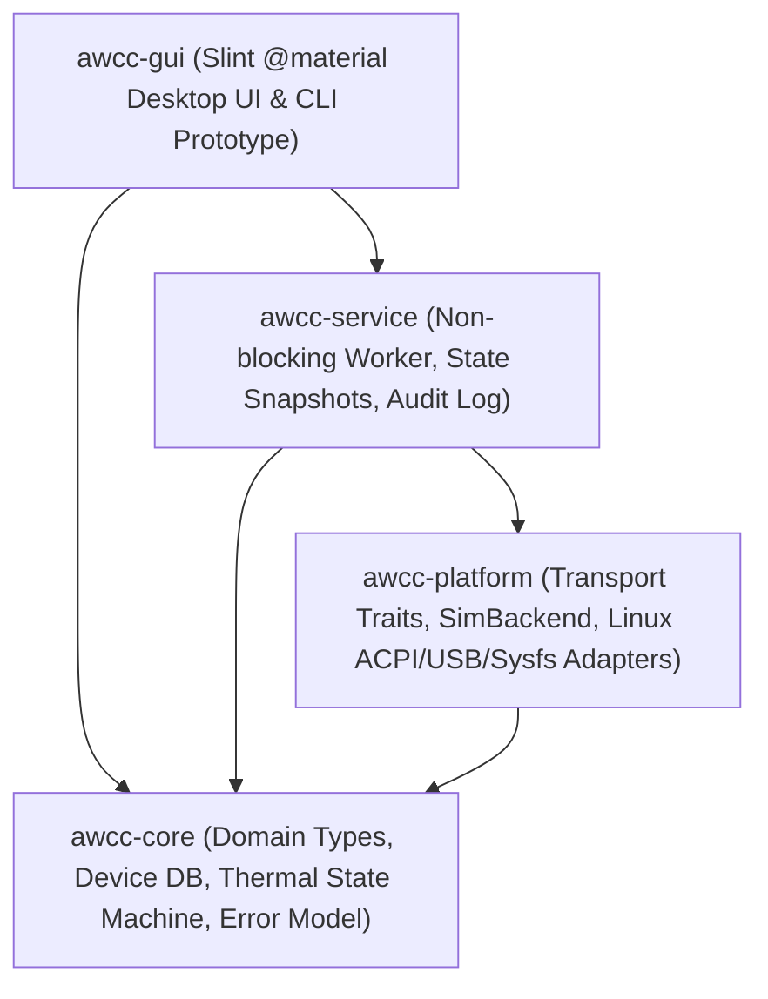

# AWCC Rust Architecture and Migration Strategy

## 1. Crate Boundaries and Workspace Layout

The `src-rust` workspace separates pure domain logic, hardware/simulated platform transports, asynchronous service orchestration, and user interfaces:



| Crate | Path | Responsibilities | Allowed Dependencies |
| :--- | :--- | :--- | :--- |
| **`awcc-core`** | `crates/awcc-core` | Pure domain types (`DeviceProfile`, `Database`, `ThermalMode`, `ThermalModeState`, `SensorReading<T>`, `OperationLifecycle`, `FanBoostStaging`, `SimScenario`), 4-tier `database.json` resolution, DMI/ACPI prefix rules, per-model `patch_modes` table, and `thiserror` error types. **Zero I/O, zero hardware access, zero UI.** | `serde`, `serde_json`, `thiserror` |
| **`awcc-platform`** | `crates/awcc-platform` | Hardware boundary traits (`ThermalTransport`, `StateStorage`) and the deterministic `SimBackend` (simulated Alienware m15 R6 `AMWW` hardware with fault injection, rollback testing, and hardware write audit logging). In Phases 2–4, hosts Linux `/proc/acpi/call`, `sysfs`, `rusb` HID, and `evdev` implementations behind the same traits. | `awcc-core`, `thiserror` |
| **`awcc-service`** | `crates/awcc-service` | Owns the active transport on a dedicated worker thread (`ThermalServiceHandle` / `ThermalWorker`), processes commands over bounded `std::sync::mpsc::sync_channel`, enforces the two-step G-Mode rollback protocol, tracks `OperationLifecycle` transitions, and publishes immutable `SystemSnapshot` updates to the UI or CLI without ever blocking the GUI thread. | `awcc-core`, `awcc-platform`, `thiserror` |
| **`awcc-gui`** | `crates/awcc-gui` | Binary crate embedding the official Slint Material 3 library (`@material` `1.1.0`), mapping `SystemSnapshot` to reactive Slint properties, handling staged user interactions, and providing both interactive desktop execution and deterministic headless PNG screenshot rendering (`--screenshot`). | `awcc-core`, `awcc-platform`, `awcc-service`, `slint`, `i-slint-backend-testing`, `png`, `anyhow` |

---

## 2. Ownership, Concurrency, and Non-Blocking Execution Model

Following `rust-concurrency` and `ownership-not-clone` guidelines:

1. **Single Owner of Hardware Transport**:
   - The `ThermalWorker` owns the `Box<dyn ThermalTransport>` and `Box<dyn StateStorage>` exclusively on a single dedicated background thread (`awcc-thermal-worker`).
   - No `Arc<Mutex<dyn ThermalTransport>>` contention exists between the GUI render loop and hardware queries.
2. **Bounded Command Channel & Snapshot Channel**:
   - UI callbacks send `ServiceCommand` messages (`Refresh`, `SetThermalMode(ThermalMode)`, `ToggleGMode`, `ApplyManualBoost { cpu, gpu }`, `SetTurbo(bool)`, `SetSimScenario(SimScenario)`) over a bounded `sync_channel(32)`.
   - The worker emits `SystemSnapshot` values over a channel polled by a lightweight Slint `Timer` (`50ms`), updating Slint properties on the main UI thread.
3. **Graceful Shutdown**:
   - Dropping `ThermalServiceHandle` or sending `ServiceCommand::Shutdown` terminates the worker loop cleanly and joins the worker thread on `Drop`.

---

## 3. Explicit Uncertainty & Lifecycle State Model

Hardware queries on Alienware WMAX can fail, return sentinel values (`0xffffffff` / `0xfe`), or time out. The Rust domain model forbids conflating unknown/failed readings with valid zero or manual states:

### 3.1 `ThermalModeState` (`Unknown != Manual`)
```rust
pub enum ThermalModeState {
    /// Confirmed hardware mode mapped from active device's USTT / GameShift table.
    Known(ThermalMode),
    /// Hardware returned a byte that does not map to any known mode (e.g., 0xFE or -1).
    /// Explicitly distinct from `ThermalMode::Manual` (0x00).
    Unknown { raw_code: Option<u32>, reason: String },
}
```

### 3.2 `SensorReading<T>` (`Unavailable != 0`)
```rust
pub enum SensorReading<T> {
    /// Confirmed live reading from hardware/simulation.
    Valid { value: T, unit: &'static str },
    /// Sensor returned sentinel or failed query; UI renders `--` with badge, never `0`.
    Unavailable { reason: String },
    /// Last known reading retained after a transient query failure.
    Stale { last_value: T, unit: &'static str, reason: String },
}
```

### 3.3 `OperationLifecycle` (Deterministic State Machine)
```rust
pub enum OperationLifecycle {
    Idle,
    Requested { description: String },
    Pending { description: String },
    Confirmed { summary: String },
    RolledBack { summary: String, reason: String },
    Failed { summary: String, error: String },
}
```

---

## 4. Zero Unsolicited Hardware Writes Guarantee

A core architectural invariant of the Rust rewrite is:

> **Opening the GUI, running passive CLI commands (`--help`, `device-info`, `query-mode`), switching tabs, refreshing telemetry, or dragging manual fan boost sliders without clicking `Apply` MUST perform zero hardware write operations (`0x15`, `0x25 0x01`, sysfs writes, or USB HID writes).**

This invariant is enforced and tested at three levels:
1. **Transport Write Audit Counter**: `ThermalTransport::write_audit_log()` records every mutating command (`WMAX 0x15`, `WMAX 0x25 0x01`, turbo write).
2. **Staged Manual Fan Boost in UI**: Dragging CPU/GPU boost sliders in `awcc-gui` only modifies `staged_cpu_boost` / `staged_gpu_boost` and sets `boost_dirty = true`. Only clicking **`Apply Manual Boost`** dispatches `ServiceCommand::ApplyManualBoost`.
3. **Automated Integration Test**: `awcc-service` and `awcc-gui` tests assert `write_audit_log().is_empty()` after full startup, initial snapshot load, passive refreshes, and uncommitted slider adjustments.

---

## 5. Phased Migration Strategy (C++ $\rightarrow$ Rust)

| Phase | Beads Issue | Scope | Parity & Verification Gate |
| :--- | :--- | :--- | :--- |
| **Phase 1 (Current)** | `awcc-1ln.1` | Workspace architecture, C++ assessment, hardware verification protocol, Figma/Material 3 spec, `awcc-core` + `awcc-platform` (`SimBackend`) + `awcc-service` + runnable `awcc-gui` (`@material`) prototype. | `cargo fmt`, `cargo clippy -D warnings`, `cargo test`, headless screenshots at `1120×720` and `880×620`, zero-write startup audit. |
| **Phase 2** | `awcc-1ln.2` (depends on `awcc-1ln.1`, `awcc-kgn`) | Real Linux `/proc/acpi/call` & `sysfs` adapter in `awcc-platform`, state-machine conformance harness against `src/tests/awcc_offline_tests.cpp`, and resolution of `0x200` / `SensorIds` open questions. | Differential trace parity between C++ and Rust across all 12 offline test scenarios + property tests. |
| **Phase 3** | `awcc-1ln.3` (depends on `awcc-1ln.2`, `awcc-h4u`) | Port `LightFX` (`187c:0550`/`0551` 33-byte HID transfers) and `EffectController` to Rust (`rusb`), plus hardware lighting zone verification. | Exact 33-byte packet golden tests matching C++ `LightFX` offline tests. |
| **Phase 4** | `awcc-1ln.4` (depends on `awcc-1ln.2`, `awcc-1ln.3`) | Port `awccd` daemon (replacing regex `popen` over `0666` socket with typed IPC), `KeyBinder` (`evdev` G-key `148` & brightness key `0x1f7`), and full CLI drop-in binary (`awcc`). | CLI argument, exit-code, and systemd/udev integration parity. |
| **Phase 5** | `awcc-1ln.5` (depends on `awcc-1ln.1`, `awcc-1ln.3`, `awcc-8jx`, `awcc-ovp`) | Complete Slint (`@material`) screens for Lighting/FX zones, Custom Fan Offset & Curve controls, Diagnostics, and bidirectional Figma Design sync. | Visual review at normal/compact sizes + hardware validation on Alienware m15 R6. |
